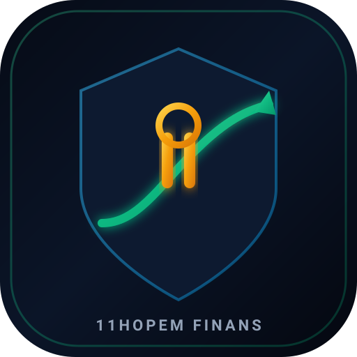

# 🛡️ 11Hopem Finansör (`finans-asistani`)

<div align="center">
  
  <p><strong>Akıllı Kişisel Finans, Borç Kapatma (Çığ & Kartopu), Kredi Zamanlama ve Yatırım Danışmanı</strong></p>

  [](https://github.com/umutocguder/finans-asistani)
  [](https://github.com/umutocguder/finans-asistani)
  [](https://11hopem.com)
  [](https://finans-asistani-ebon.vercel.app)
</div>

---

## 📌 1. Proje Vizyonu ve Konsept
**11Hopem Finansör**, kullanıcının gelir, gider ve tüm borç kalemlerini (kredi kartları, KMH, tüketici kredileri, şahsi borçlar) tek bir matematiksel kasada toplayan; **"Borçlarımı en az faiz ödeyerek nasıl kapatırım?", "Ne zaman kredi çekmeliyim?"** ve **"Nakit fazlamla neye nasıl yatırım yapmalıyım?"** sorularına rasyonel, simülatif ve uygulanabilir yanıtlar veren akıllı bir finans danışmanlığı platformudur.

Platform, Türkiye'nin yüksek enflasyon ve yüksek faiz ortamındaki finansal dinamiklerini temel alır:
- Aylık %4.5 - %5 faizli kredi kartı ve KMH borçlarını ödemenin **risksiz ve garantili %70 yıllık kâr** olduğu gerçeğini modelleyerek zehirli faizleri önceliklendirir.
- Borç konsolidasyonu (refinansman) imkanlarını hesaplayarak aylık nakit yükünü hafifletir.
- Borç/Gelir (DTI) oranına göre kredi çekme zamanlamasını yeşil/sarı/kırmızı güvenlik kurallarıyla denetler.

---

## 🌐 2. Canlı Bağlantılar ve Proje Künyesi
- **Canlı Web Platformu:** [https://finans-asistani-ebon.vercel.app](https://finans-asistani-ebon.vercel.app)
- **Özel GitHub Deposu:** [https://github.com/umutocguder/finans-asistani](https://github.com/umutocguder/finans-asistani)
- **Marka & Telif Sahibi:** [11Hopem](https://11hopem.com)
- **Geliştirici İletişim:** `umutocgdr@gmail.com`
- **Antigravity Proje Kimliği:** `7de8582d-e3a4-481b-81aa-13ced53a98f1`

---

## 🏢 3. Finansal Matematik ve Karar Modelleri

### 1. Çığ Yöntemi (Avalanche Strategy)
En yüksek faiz oranına sahip borcu (KMH, Kredi Kartı) ilk sıraya alarak toplamda ödenen faizi minimize eden en rasyonel matematiksel modeldir.

### 2. Kartopu Yöntemi (Snowball Strategy)
En düşük bakiyeli borcu ilk sıraya alıp hızla kapatarak borç sayısını azaltan ve psikolojik rahatlama sağlayan davranışsal modeldir.

### 3. Kredi Birleştirme (Debt Consolidation Engine)
Dağınık ve yüksek faizli kart/KMH borçlarını tek bir uygun oranlı tüketici kredisinde toplayıp aylık nakit akışını anında artıran refinansman motorudur.

### 4. Kredi Çekme Zamanlama ve Uygunluk Kuralları
- Borç / Gelir Oranı (DTI) <%35: Sağlıklı
- DTI %35-%50: Orta Risk (Yalnızca borç kapatma kredisi için uygun)
- DTI >%50: Yüksek Risk (Asla kredi çekilmemeli)
- Kredi sonrası kalan serbest nakit akışı eksiye düşmemelidir.

---

## 🚀 4. Temel Fonksiyonlar & İnteraktif Modüller
- **Finansör AI Masası (`tab-advisor`):** Kullanıcının serbest metinle *"50.000 TL nakit fazlam var, nereye koymalıyım?"* veya *"Bu ay kredi çekeyim mi?"* sorularını analiz edip adım adım eylem planı sunan karar motoru.
- **Borç & Gelir Kütüğü (`tab-debts`):** Kredi kartı, KMH, tüketici kredisi ve şahsi borçların bakiye, asgari ve faiz oranlarıyla yönetildiği tablo.
- **Çığ & Kartopu Simülatörü (`tab-payoff`):** İki yöntemin kapanış ayı ve toplam faiz karşılaştırması.
- **Kredi Çekme Zamanlama Analizi (`tab-loan`):** Yeni kredi taksiti simülatörü ve 100 üzerinden finansal sağlık skoru.
- **Varlık & Yatırım Dağılımı (`tab-investment`):** Acil durum fonu, altın, hisse senedi ve para piyasası fonu (PPF) dağılım şablonları.

---

## 🏗️ 5. Mimari, Teknoloji Yığını & Dizin Ağacı
```
finans-asistani/
├── assets/                          # Vektörel ve Raster Marka Varlıkları
│   ├── logo.svg
│   ├── favicon.svg
│   ├── favicon.ico
│   ├── apple-touch-icon.png
│   └── og-image.png
├── public/                          # Canlı Dağıtım Paketi
│   ├── index.html                   # İnteraktif Finansör Arayüzü
│   ├── assets/
│   ├── src/                         # Tarayıcı ES Modülleri
│   ├── robots.txt
│   └── sitemap.xml
├── supabase/                        # Supabase PostgreSQL Şeması & RLS
│   └── schema.sql                   # financial_profiles, debts, simulations tabloları
├── src/                             # Çekirdek Finans Motorları & Servisler
│   ├── engines/
│   │   ├── debtEngine.js            # Çığ, Kartopu ve Konsolidasyon
│   │   ├── loanAdvisorEngine.js     # Kredi Zamanlaması ve DTI
│   │   ├── investmentEngine.js      # Borç vs Yatırım ve Varlık Dağılımı
│   │   └── financeAdvisorEngine.js  # Yüksek Seviye AI Danışman
│   ├── services/
│   │   ├── supabaseService.js       # Supabase PostgreSQL PostgREST İstemcisi
│   │   └── backupService.js         # SHA-256 Kriptografik Yedekleme
│   └── telemetry/
│       └── telemetryService.js      # PII Temizlemeli Firebase REST
├── tests/
│   ├── finance.test.js              # Finans Matematik Birim Testleri
│   └── supabase.test.js             # Supabase Entegrasyon Testleri
├── .github/workflows/
│   └── ci-cd.yml                    # Otonom CI/CD Hattı
├── AGENTS.md                        # AI Ajan Standartları
├── CLAUDE.md                        # Claude Senkronizasyonu
├── WORKLOG.md                       # AI Handoff Ready Günlüğü
├── package.json
└── vercel.json                      # Vercel Konfigürasyonu
```

---

## 🛡️ 6. Sıfır Veri Sızıntısı, Supabase Güvenliği & Yasal Uyarı
- **Supabase PostgreSQL & RLS:** Kullanıcının kalıcı gelirleri, borç tutarları ve finansal verileri tarayıcı önbelleğine (localStorage) emanet edilmez; doğrudan Row Level Security (RLS) korumalı Supabase PostgreSQL veritabanında saklanır.
- **Kriptografik Yedekleme:** Tek tıkla JSON formatında indirilen yerel kopyalar SHA-256 kriptografik özetiyle doğrulanır.
- **Yasal Sorumluluk Sınırı:** Bu platform bir bütçe simülasyon ve finansal matematik hesaplama aracıdır; SPK veya BDDK kapsamında yatırım danışmanlığı içermez.

---

## 📈 7. Telemetri & Canlı Metrikler
Firebase REST entegrasyonu `TelemetryService.scrubSensitiveData` filtresi üzerinden çalışır; finansal rakamlar, isimler veya gelir miktarları kesinlikle loglanmaz; yalnızca anonim arayüz kullanım olayları aktarılır.

---

## 💾 8. Otonom Yedekleme Komutları
```bash
# Yerel kriptografik yedek alma
npm run backup
```

---

## 🧪 9. Kurulum, Test ve Dağıtım Komutları
```bash
# Otomatik Testleri Koşturma (%100 Başarı)
npm test

# Prodüksiyon Paketini Derleme
npm run build

# Yerel Sunucuyu Başlatma
npm start

# Vercel'e Canlı Dağıtım
npx -y vercel --prod --yes
```

---

## 🖋️ 10. 11Hopem İmzası ve Telif Hakları
Bu proje **[11Hopem](https://11hopem.com)** tarafından geliştirilmiştir.

> **Telif Hakkı © 2026 11Hopem. Tüm hakları saklıdır.**  
> Resmi Web Sitesi: [https://11hopem.com](https://11hopem.com)
